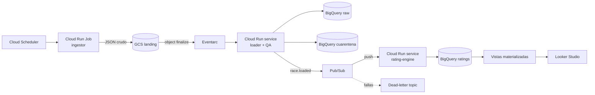

# ADR-003: Arquitectura orientada a eventos en GCP

- **Estado:** Propuesto
- **Fecha:** 2026-10-22
- **Relacionado:** ADR-001 (modelo de rating)

## Contexto

El rating (Glicko-2, ADR-001) debe actualizarse después de cada gran premio sin
intervención manual. Objetivo secundario explícito: aprender arquitectura orientada
a eventos en GCP (Cloud Run, Eventarc, Pub/Sub), fuera del stack habitual del autor.

Restricciones:
- Jolpica-F1 no emite eventos: no avisa cuando publica resultados. Hay que consultarla.
- Límite de Jolpica: 4 requests por segundo y 500 por hora.
- Glicko-2 depende del orden: la ronda N solo se puede calcular después de la N-1.
- Costo objetivo: cercano a cero, con alerta de presupuesto desde el día uno.

## Decisión

**Polling en el borde, eventos hacia adentro.** Lo único programado es la consulta a la
fuente externa; desde que llega un dato nuevo, todo avanza por eventos (coreografía,
sin orquestador central).

### Componentes
1. **Cloud Scheduler → Cloud Run Job `ingestor`.** Corre cada pocas horas los domingos
   y lunes. Compara la última ronda cargada con la disponible en Jolpica; si hay una
   nueva, descarga resultados, clasificación y estados respetando el rate limit.
   Escribe el JSON crudo en GCS, inmutable, con ruta `season=YYYY/round=NN/`.
2. **GCS → Eventarc → Cloud Run `loader`.** Se dispara al llegar el archivo. Valida el
   esquema, clasifica el `status` de los abandonos, envía lo no clasificado a cuarentena,
   carga BigQuery raw y publica `race.loaded` con `{season, round}`.
3. **Pub/Sub → Cloud Run `rating-engine`.** Suscripción push. Calcula Glicko-2 para esa
   ronda a partir del estado de la ronda anterior y escribe el historial de ratings.
   Los mensajes que fallan repetidamente van a un dead-letter topic.
4. **Consumo:** vistas materializadas en BigQuery (ranking vigente, mejor pico histórico)
   y un dashboard en Looker Studio.

### Garantías de diseño
- **Idempotencia:** Pub/Sub entrega al menos una vez, así que el mismo mensaje puede
  llegar dos veces. El `rating-engine` escribe con `MERGE` por `(season, round, driver)`:
  recalcular una ronda produce el mismo resultado.
- **Orden:** antes de calcular la ronda N, el `rating-engine` verifica que la N-1 exista.
  Si falta, rechaza el mensaje (nack) y Pub/Sub reintenta con backoff.
- **Backfill:** la carga histórica (2000 en adelante) no pasa por eventos. Un Cloud Run Job
  de backfill usa la misma librería de cálculo y recorre las rondas en orden.
  Una sola lógica, dos formas de invocarla.
- **Trazabilidad:** cada fila de ratings guarda el archivo de origen en GCS y la versión
  del modelo.

## Alternativas consideradas
- **Cloud Composer (Airflow):** el patrón conocido por el autor. Descartado: un
  orquestador siempre encendido para un evento cada dos semanas es sobredimensionado
  y caro, y no cumple el objetivo de aprendizaje.
- **Dataflow:** sobredimensionado para pocos KB por carrera.
- **Batch programado completo:** más simple, pero no ejercita eventos.
- **Loader publica directo, sin Eventarc:** un paso menos. Se mantiene Eventarc porque
  desacopla la llegada del archivo de su procesamiento y es parte del aprendizaje buscado.
  En un sistema productivo de este tamaño se podría colapsar.

## Consecuencias
- (+) Costo cercano a cero: todo escala a cero entre carreras.
- (+) Cada pieza se puede reprocesar por separado (reemitir un archivo o un mensaje).
- (−) Más piezas móviles que un cron; la observabilidad (logs, alertas del DLQ) es obligatoria.
- (−) La lógica de orden vive en el `rating-engine`, no en la infraestructura.

## Pendientes
- IAM: una service account por servicio con permisos mínimos.
- Alerta cuando haya mensajes en el dead-letter topic o filas en cuarentena.
- Infraestructura como código (Terraform) en una segunda iteración.
